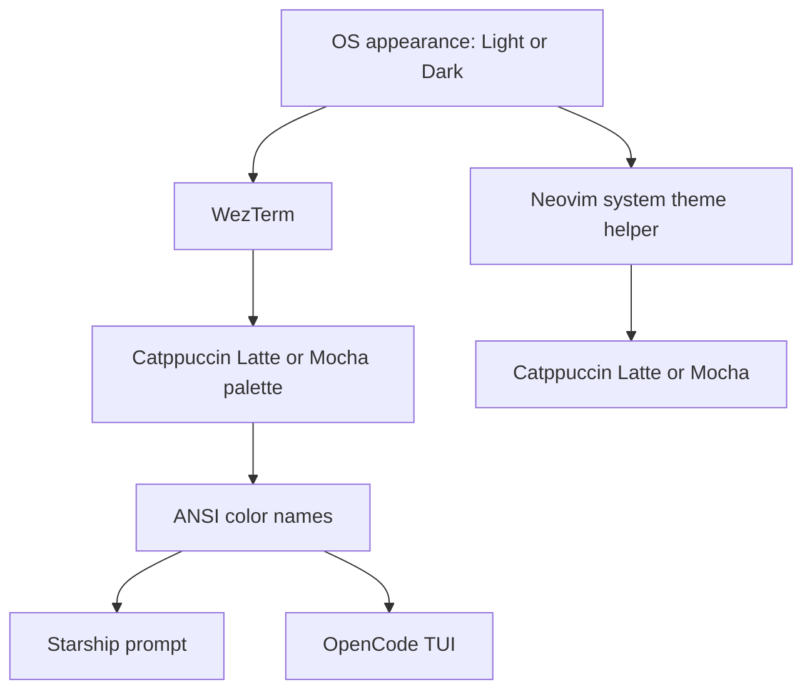

A dark terminal in a light desktop is a flash of glare every time the window
changes focus. The fix is to make the terminal own the palette and let the
tools inside inherit it, instead of teaching each tool to read the desktop on
its own.

This is the current setup:

| Layer    | Appearance source                  | How it switches                            |
| -------- | ---------------------------------- | ------------------------------------------ |
| WezTerm  | Desktop appearance API             | Reloads the config when the system changes |
| Starship | Terminal ANSI palette              | Resolves colors on every prompt render     |
| OpenCode | Terminal palette and appearance    | Follows the terminal while the TUI runs    |
| Neovim   | OS settings, not the terminal      | Refreshes on focus and resume              |

The terminal is the only place that needs a desktop-specific check. Everything
else either receives the palette through ANSI colors or reads the terminal's
reported appearance.



Neovim is the exception: it does not trust terminal colors and runs its own
detection, which is covered in the [Neovim config](/blogs/config/neovim-config/)
post. The other three are new.

## WezTerm

WezTerm exposes the desktop appearance through `wezterm.gui.get_appearance()`.
It returns `Light`, `Dark`, `LightHighContrast`, or `DarkHighContrast`, and
WezTerm reloads the config whenever the appearance changes. That means the
config file only has to map the current value to a color scheme:

```lua
local wezterm = require("wezterm")

local config = wezterm.config_builder()

-- wezterm.gui is not available to the mux server, so fall back to dark there.
local function appearance()
  if wezterm.gui then
    return wezterm.gui.get_appearance()
  end

  return "Dark"
end

-- WezTerm reloads the config when the desktop appearance changes, so this
-- check runs again on every light/dark switch.
local is_dark = appearance():find("Dark") ~= nil

config.color_scheme = is_dark and "Catppuccin Mocha" or "Catppuccin Latte"

config.font = wezterm.font_with_fallback({
  "Maple Mono NF",
  "Noto Sans Mono CJK SC",
})
config.font_size = 12.0
config.line_height = 1.1

config.window_padding = {
  left = 8,
  right = 8,
  top = 6,
  bottom = 6,
}
config.window_decorations = "RESIZE"

config.default_cursor_style = "BlinkingBar"
config.cursor_blink_rate = 500

config.use_fancy_tab_bar = false
config.hide_tab_bar_if_only_one_tab = true
config.tab_max_width = 28

-- Pick up edits to this file without restarting, and pick up appearance
-- changes without touching the file at all.
config.automatically_reload_config = true
config.check_for_updates = false

return config
```

Two details are easy to miss.

`wezterm.gui` is only available in the GUI process. The mux server also
evaluates the config, so calling `wezterm.gui.get_appearance()` without a guard
fails there. The fallback keeps the mux usable; the GUI reloads the config and
picks the right scheme anyway.

`find("Dark")` handles all four return values. Comparing with `== "Dark"`
would silently turn high-contrast dark mode into the light scheme.

The font list is a fallback chain, not a preference list: Maple Mono NF draws
the code and prompt glyphs, while Noto Sans Mono CJK SC covers Chinese text
without replacing the Latin font.

## Starship

Starship has no desktop appearance API and no automatic palette switching. Its
`palette` option is a plain name, and environment variables are not expanded
inside the config file. The prompt follows the system anyway because it uses
ANSI color names instead of hex values:

```toml
"$schema" = 'https://starship.rs/config-schema.json'

# Styles use ANSI color names instead of hex values. Starship does not query
# the desktop itself, so the names resolve through the terminal's palette,
# which WezTerm swaps when the system appearance changes.
format = """
$os\
$username\
$directory\
$git_branch\
$git_status\
$c\
$rust\
$golang\
$nodejs\
$php\
$java\
$kotlin\
$haskell\
$python\
$conda\
$time\
$cmd_duration\
$line_break\
$character"""

[os]
disabled = false
style = "bold red"
format = '[ $symbol ]($style)'

[os.symbols]
Windows = ""
Ubuntu = "󰕈"
SUSE = ""
Raspbian = "󰐿"
Mint = "󰣭"
Macos = "󰀵"
Manjaro = ""
Linux = "󰌽"
Gentoo = "󰣨"
Fedora = "󰣛"
Alpine = ""
Amazon = ""
Android = ""
AOSC = ""
Arch = "󰣇"
Artix = "󰣇"
CentOS = ""
Debian = "󰣚"
Redhat = "󱄛"
RedHatEnterprise = "󱄛"

[username]
show_always = true
style_user = "bold red"
style_root = "bold red"
format = '[ $user ]($style)'

[directory]
style = "bold blue"
format = '[ $path ]($style)'
truncation_length = 3
truncation_symbol = "…/"

[directory.substitutions]
"Documents" = "󰈙 "
"Downloads" = " "
"Music" = "󰝚 "
"Pictures" = " "
"Developer" = "󰲋 "

[git_branch]
symbol = " "
style = "bold magenta"
format = '[ $symbol$branch ]($style)'

[git_status]
# gitoxide counts the contents of an uninitialized submodule as untracked,
# while `git status` ignores them. Use the executable so the prompt agrees.
use_git_executable = true
style = "bold yellow"
format = '[ ($all_status$ahead_behind )]($style)'

[nodejs]
symbol = ""
style = "bold green"
format = '[$symbol $version ]($style)'

[c]
symbol = " "
style = "bold green"
format = '[$symbol $version ]($style)'

[rust]
symbol = ""
style = "bold green"
format = '[$symbol $version ]($style)'

[golang]
symbol = ""
style = "bold green"
format = '[$symbol $version ]($style)'

[php]
symbol = ""
style = "bold green"
format = '[$symbol $version ]($style)'

[java]
symbol = " "
style = "bold green"
format = '[$symbol $version ]($style)'

[kotlin]
symbol = ""
style = "bold green"
format = '[$symbol $version ]($style)'

[haskell]
symbol = ""
style = "bold green"
format = '[$symbol $version ]($style)'

[python]
symbol = ""
style = "bold green"
format = '[$symbol $version(\(#$virtualenv\)) ]($style)'

[conda]
symbol = "  "
style = "bold cyan"
format = '[ $symbol$environment ]($style)'
ignore_base = false

[time]
disabled = false
time_format = "%R"
style = "bold cyan"
format = '[ $time ]($style)'

[line_break]
disabled = true

[character]
disabled = false
success_symbol = '[❯](bold green)'
error_symbol = '[❯](bold red)'
vimcmd_symbol = '[❮](bold green)'
vimcmd_replace_one_symbol = '[❮](bold magenta)'
vimcmd_replace_symbol = '[❮](bold magenta)'
vimcmd_visual_symbol = '[❮](bold yellow)'

[cmd_duration]
show_milliseconds = true
format = '[ $duration ]($style)'
style = "bold yellow"
disabled = false
show_notifications = true
min_time_to_notify = 45000
```

One setting in that file is not about color. Starship reads repository state
with gitoxide by default, and gitoxide counts the files inside an uninitialized
submodule as untracked. This repository keeps `themes/blowfish` as a submodule
but has the theme files on disk without a `.git` entry, so `git status` was
clean while the prompt showed a `?`. Setting `use_git_executable = true` makes
Starship ask git itself, which brings the prompt back in line with `git status`.
It costs one git process per prompt, which is a fair trade for a status line
that means what the command says.

The previous config pinned all four Catppuccin palettes as hex values and
selected `catppuccin_mocha`. That looked right in dark mode and ignored the
desktop entirely. Removing the palette tables and using `red`, `blue`, `cyan`,
and friends delegates the choice to WezTerm. When the terminal switches from
Mocha to Latte, the prompt switches with it on the next render; no shell reload
and no second config file are involved.

The cost is the filled powerline bar. A filled segment needs a background and a
foreground that contrast with each other, and ANSI names do not guarantee that
pairing in both flavors: the same `red` is light in Mocha and dark in Latte, so
one fixed foreground color cannot work for both. The prompt is now a flat line
of colored text. Terminal palettes are designed for text-on-background
contrast, so foreground-only styling is the part that survives both modes.

`palette` could have been switched with `STARSHIP_CONFIG` and two files, but
that needs a detector in the shell and only updates when a new prompt starts.
ANSI names update on every command for free.

## OpenCode

OpenCode's terminal settings live in `cli.json`, separate from the server and
project config in `opencode.json`. The theme has two independent fields: `name`
selects the theme, and `mode` selects dark, light, or `system`. The current file
keeps Catppuccin and asks for the mode that matches the terminal:

```json
{
  "$schema": "https://opencode.ai/v2/cli.json",
  "theme": {
    "name": "catppuccin",
    "mode": "system"
  },
  "animations": true,
  "session": {
    "scrollbar": true,
    "permissions": "prompt"
  },
  "keybinds": {
    "session.half.page.up": "ctrl+u",
    "session.half.page.down": "ctrl+d",
    "session.line.up": "ctrl+k",
    "session.line.down": "ctrl+j",
    "session.message.previous": "ctrl+alt+k",
    "session.message.next": "ctrl+alt+j",
    "session.first": "ctrl+g,home,alt+home,ctrl+alt+g",
    "session.last": "end,ctrl+alt+shift+g",
    "which-key.toggle": "ctrl+alt+shift+w",
    "input.delete.to.line.end": "none",
    "input.newline": "shift+return,ctrl+return,alt+return",
    "input.visual.line.end": "none",
    "prompt.editor": "alt+e"
  }
}
```

`mode: "system"` means OpenCode follows the terminal's reported light or dark
appearance. The theme itself still supplies its own Catppuccin colors, so this
picks the matching half of the theme rather than sampling the terminal.

There is also a theme named `system`, which derives its colors from the
terminal's foreground, background, and ANSI palette. Setting both fields to
`system` gives a TUI that copies WezTerm exactly, including any future palette
change. Keeping `catppuccin` is the safer choice here: the terminal and the TUI
then agree on the flavor even if one of them updates its built-in palette.

The TUI watches `cli.json` and applies valid edits without a restart.

## Neovim

Neovim already follows the system through
[`lua/config/system_theme.lua`](/blogs/config/neovim-config/#theme-switching).
It does not read the terminal palette, because a terminal does not tell a
full-screen application which colors it is using. Instead it checks the OS
directly: `gsettings` on Linux, the registry on Windows and WSL, and `defaults`
on macOS. That is why it belongs in the same story but not in the same
mechanism.

Keeping the Neovim flavor pair aligned with WezTerm is enough:

```lua
-- lua/plugins/colorscheme.lua
background = {
  light = "latte",
  dark = "mocha",
}
```

## Files and install

The files live next to the other dotfiles:

```text
dotfiles
├── opencode
│   └── cli.json
├── wezterm
│   └── wezterm.lua
└── zsh
    └── starship.toml
```

Install directly from GitHub:

```sh
curl -fsSL https://raw.githubusercontent.com/tihaya-anon/tihaya-anon.github.io/main/scripts/install-theme-config.sh | sh
```

The script copies the three files above into
`${XDG_CONFIG_HOME:-$HOME/.config}`, moving any different existing file to a
timestamped backup first:

```text
wezterm/wezterm.lua  -> ~/.config/wezterm/wezterm.lua
zsh/starship.toml    -> ~/.config/starship.toml
opencode/cli.json    -> ~/.config/opencode/cli.json
```

Check the plan without changing anything:

```sh
curl -fsSL https://raw.githubusercontent.com/tihaya-anon/tihaya-anon.github.io/main/scripts/install-theme-config.sh | sh -s -- --dry-run
```

If the repo is already cloned locally, run the same installer from the
checkout:

```sh
sh scripts/install-theme-config.sh
```

Use `--no-backup` to fail instead of replacing an existing file, or `--ref` to
read the files from another branch.

The [Zsh installer](/blogs/config/zsh-config/#install-on-a-new-machine) writes
the same three theme files and also handles `~/.zshrc`, `~/.zprofile`, and the
plugins. Running either script is enough; run both and the second one reports
the shared files as up to date.

To verify each layer:

```sh
wezterm show-keys >/dev/null   # config parses
starship prompt                # colors come from the terminal palette
opencode                       # Ctrl+P, Open settings, Theme
```

Switch the desktop between light and dark. WezTerm should repaint immediately,
Starship on the next command, OpenCode while it is open, and Neovim when it
regains focus.
